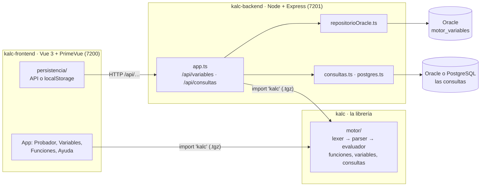

# Kalc

Un **motor de fórmulas** con la misma sintaxis y el mismo comportamiento que Excel en castellano
(`SI(A>1,5; "alto"; "bajo")`, `#¡DIV/0!`, `-2^2 = 4`), con **variables con nombre** que pueden ser
constantes, fórmulas, tablas escritas a mano o consultas a Oracle (o a PostgreSQL). Más una API que guarda las
variables en la base y una aplicación web para probarlo.

> Este repositorio tiene las tres partes, cada una en su carpeta con su README y su CLAUDE.md.
> Acá está solo lo que es de las tres: la arquitectura y cómo instalar y levantar todo.

## Las tres partes

| Carpeta | Qué es | Depende de | Puerto |
|---|---|---|---|
| [`kalc`](kalc) | La librería: el motor de fórmulas (TypeScript puro, sin dependencias), que se empaqueta en `kalc-X.Y.Z.tgz` | nada | — |
| [`kalc-backend`](kalc-backend) | La API de variables (Node + Express + `oracledb` y `pg`): las guarda en Oracle (`motor_variables`) y corre las variables de consulta, en Oracle o PostgreSQL | `kalc` (el `.tgz`) | 7201 (8082 publicada) |
| [`kalc-frontend`](kalc-frontend) | La aplicación en Vue 3 + PrimeVue: Probador, Variables, Funciones y Ayuda | `kalc` (el `.tgz`) y `kalc-backend` por HTTP | 7200 |



El mismo diagrama, con más detalle, está en [`docs/arquitectura.drawio`](docs/arquitectura.drawio)
(se abre con [draw.io](https://www.drawio.com/)).

Reglas entre las partes:

- **Nadie importa código de otra carpeta.** La librería se usa solo por el paquete (`import …
  from 'kalc'`), que cada una tiene commiteado en `paquetes/`. La API se usa solo por HTTP
  (`/api/…`): en desarrollo, Vite se la reenvía al 7201; publicada, el IIS al 8082.
- **El motor no guarda ni corre SQL**: define las interfaces (`RepositorioVariables`,
  `EjecutorConsultas`) y cada aplicación pone las suyas. La base y sus scripts son de
  `kalc-backend` (`db/`); `kalc-frontend` no tiene credenciales.
- **kalc-backend corre el SQL que tiene guardado**, nunca el que manda el navegador.

## Instalar y levantar todo

Requisitos: Node 22.12 o posterior. Para guardar las variables en una base, una Oracle (sirve
[Oracle Database Free](https://www.oracle.com/database/free/)); puede ser una sola, o varias con
nombre: una guarda las variables (el almacén) y las consultas corren en las que se elijan. Para
las consultas de ejemplo, un PostgreSQL con la base de ejemplo (`kalc-backend/db/postgres/`, datos
inventados): ver "La base de ejemplo" en el README de `kalc-backend`. Sin base, la aplicación
guarda las variables en el navegador y no corre consultas.

```sh
# 1. el repositorio
git clone <url de este repositorio> kalc
cd kalc

# 2. las dependencias de cada parte (npm 11: con el 10 que traen algunos Node falla kalc-backend)
npm run instalar

# 3. la conexión a la base, en kalc-backend: una (ORACLE_USUARIO, ORACLE_CLAVE, ORACLE_CONEXION)
#    o varias con nombre (CONEXIONES, ALMACEN, CONSULTAS y ORACLE_<NOMBRE>_* / POSTGRES_<NOMBRE>_*;
#    ver .env.example)
cp kalc-backend/.env.example kalc-backend/.env
#    y en kalc-frontend, que use la API (sin esto, guarda en el navegador y no corre consultas)
cp kalc-frontend/.env.example kalc-frontend/.env

# 4. la primera vez, crear la tabla en el esquema del almacén: kalc-backend/db/oracle/variables.sql (con sqlplus)
#    y, para los ejemplos, la base PostgreSQL: kalc-backend/db/postgres/crear.sql (con psql)

# 5. levantar: kalc-frontend arranca también kalc-backend (de ../kalc-backend)
npm start   # http://localhost:7200, la API en el 7201
```

Desde la raíz, el `package.json` tiene atajos (sin dependencias propias): `npm start` o `npm run dev` (el paso 5),
`npm run instalar` (el paso 2), `npm test`, `npm run typecheck` (las tres partes) y `npm run pack` (el motor).

Para trabajar solo en el motor alcanza con `kalc` (`npm test`); no necesita base ni las otras dos
partes.

## Cambiar el motor

1. En `kalc`: el cambio con sus tests y anotado en "Sin publicar" del `CHANGELOG.md`;
   `npm version patch|minor|major` (corre tests y typecheck, le pone número y fecha al CHANGELOG,
   regenera `docs/funciones.md`, commitea y sube el tag) y `npm run pack` → `packs/kalc-X.Y.Z.tgz`,
   que lleva también el CHANGELOG y la referencia de funciones.
2. En `kalc-backend` y en `kalc-frontend`, las dos con la misma versión (el formato de las
   variables sale de ahí):

   ```sh
   cp ../kalc/packs/kalc-X.Y.Z.tgz paquetes/
   npm install ./paquetes/kalc-X.Y.Z.tgz
   rm paquetes/kalc-<la anterior>.tgz
   ```

3. En `kalc-frontend`, la solapa Funciones se arma sola desde el registro; la Ayuda no: si la
   versión trae funciones o reglas nuevas, agregarlas ahí (lo que cambió está en el CHANGELOG).

La API pública de la librería está congelada desde la 1.0.0: agregar algo es minor; sacar o
cambiar algo, major (ver el README de `kalc`).

## Publicar en un servidor

Las dos aplicaciones se pueden publicar en un servidor Windows con IIS (alcanza con Node 18: por
eso el motor compila a ES2022). El IIS sirve kalc-frontend compilado y le reenvía `/kalc/api/` a
kalc-backend, que corre como tarea programada:

```
navegador ──► IIS  /kalc/       kalc-frontend compilado   C:\inetpub\wwwroot\kalc
                   /kalc/api/ ─► kalc-backend, puerto 8082  C:\app\kalc-backend (tarea KalcBackend)
                                  └─► Oracle (y PostgreSQL, si hay)
```

### `scripts/publicar.ps1`

Desde la PC de desarrollo, en esta carpeta, en PowerShell (no Git Bash: convierte `\\` en `\`).
No hace falta entrar al servidor. El servidor va en `-Servidor` o en la variable de entorno
`KALC_SERVIDOR`:

```powershell
.\scripts\publicar.ps1 -Servidor <servidor>                 # kalc-backend y kalc-frontend; al final, qué quedó publicado
.\scripts\publicar.ps1 -Servidor <servidor> -Solo frontend  # o -Solo backend
.\scripts\publicar.ps1 -Servidor <servidor> -Prueba         # compila y muestra qué copiaría, sin copiar nada
.\scripts\publicar.ps1 -Servidor <servidor> -Forzar         # publica aunque no haya cambios
.\scripts\publicar.ps1 -Servidor <servidor> -Verificar      # solo compara lo publicado con el repositorio
.\scripts\publicar.ps1 -Servidor <servidor> -Usuario <u>    # la cuenta local del servidor para el net use (si no, la pregunta)
```

Si Windows no deja correr el script ("la ejecución de scripts está deshabilitada"):
`powershell -ExecutionPolicy Bypass -File .\scripts\publicar.ps1 -Servidor <servidor>`.

Qué hace, en orden:

1. **Revisa el repositorio contra el remoto** (`git fetch`). Si la copia local está atrasada,
   ofrece hacer `git pull`; si no, no publica: sería una versión vieja. Si hay cambios sin
   commitear o sin pushear, avisa y pregunta si seguir: lo publicado tiene que poder reconstruirse
   desde el remoto (con cambios sin commitear, la versión del pie lleva `+cambios`). Una parte cuya
   carpeta no cambió desde el commit publicado se saltea (salvo `-Forzar`): así se puede correr
   siempre, sin pensar, y no reinicia la API si el backend no cambió.
2. **Conecta la carpeta compartida** `\\<servidor>\c` si no está (`net use`, pide la contraseña):
   `robocopy` no pide credenciales. La conexión dura hasta cerrar la sesión de Windows. Si dice
   `error 1219`: `net use \\<servidor>\c /delete` y repetir.
3. **Publica kalc-backend** con su `npm run publicar`, que compila, copia a `C:\app\kalc-backend` y
   **reinicia la API sin entrar al servidor**: crea la marca `publicando` en esa carpeta, la API la
   ve y se cierra sola (así no quedan archivos en uso), copia, borra la marca, y la tarea
   `KalcBackend`, que vuelve a arrancar node al minuto de que termina, levanta la versión nueva.
   Espera hasta 2 minutos y medio a que `/kalc/api/version` responda con el commit publicado.
4. **Publica kalc-frontend** con su `npm run publicar`: compila con base `/kalc/` y copia a
   `C:\inetpub\wwwroot\kalc`. El IIS la sirve enseguida, sin reiniciar nada.
5. **Verifica**: compara lo que quedó publicado con el repositorio (lo mismo que `-Verificar`).

No usa ejecución remota (WinRM, `schtasks /S`, etc.).

**La primera vez** la tarea `KalcBackend` todavía no existe, y hay pasos en el servidor, en
PowerShell como administrador. El script lo detecta (falta `C:\app\kalc-backend\.env`) y los
muestra antes de seguir: crear el `.env`, `servicio.ps1 -Accion instalar` (la tarea y el firewall)
y, después de publicar kalc-frontend, `servicio.ps1 -Accion iis` (verifica que el IIS llegue a la
API). Los detalles están en "Despliegue" del README de kalc-backend.

**Si algo falla:**

| Qué | Qué hacer |
|---|---|
| kalc-backend no vuelve con la versión nueva | en el servidor, `.\scripts\servicio.ps1 -Accion estado` (en `C:\app\kalc-backend`) muestra la tarea y el log; `-Accion reiniciar` la vuelve a levantar |
| robocopy da ERROR 32 (archivo en uso) | la API no se cerró (una versión anterior a la marca): en el servidor, `-Accion detener`, y publicar de nuevo |
| robocopy da 1326 o 1219 | usuario o contraseña del `net use`, o una conexión con otras credenciales (ver el paso 2) |
| se cambió el `.env` del servidor | `-Accion reiniciar` en el servidor (la API lo lee al arrancar), o publicar de nuevo |

Lo que el script no hace: actualizar la librería. Si cambió el motor, antes van la versión nueva en
`kalc`, `npm run pack` y el `.tgz` nuevo en las otras dos, commiteado (ver [Cambiar el
motor](#cambiar-el-motor)); el script publica con el `.tgz` que cada una tiene.

Cada parte también se puede publicar sola, desde su carpeta, con `npm run publicar` y sus
variables de entorno (ver "Despliegue" en su README): el script de acá solo las define, corre los
dos en orden y verifica.

### ¿Qué está publicado?

`.\scripts\publicar.ps1 -Servidor <servidor> -Verificar`, o el pie de la app, que lo dice para las
dos partes:

```
v0.1.0 · 0f7b40ea del 14/10/2026 · API v1.0.0 · ae86a1a3 del 14/10/2026
└ kalc-frontend: versión, commit, fecha del build   └ kalc-backend (GET /api/version)
```

`+cambios` después del commit: se publicó con cambios sin commitear. Si no aparece la parte de la
API, kalc-backend no responde (o es una versión anterior a esa ruta). La versión de Kalc que usa la
API está en `http://<servidor>/kalc/api/version` (`kalc`).

## Historia

Al principio todo estaba en `kalc`: la librería (`motor/`), su demo (`frontend/`), la API
(`backend/`) y los scripts de la base (`db/`). El 14/10/2026 se separó en tres partes: la API y
`db/` (hoy `db/oracle/`) pasaron a `kalc-backend`, y la demo a `kalc-frontend`, fusionada con
`kalc-demo`, una aplicación mínima que ya usaba Kalc desde el `.tgz`.

El 15/10/2026, varias bases (Kalc 1.5.0): kalc-backend lee conexiones con nombre (`CONEXIONES`,
`ALMACEN`, `CONSULTAS`) y cada variable de consulta puede elegir en cuál corre. El mismo día,
consultas en PostgreSQL (Kalc 1.5.1, que no lee `x::int` como un parámetro): una conexión
`POSTGRES_<NOMBRE>_*` en kalc-backend, y una base PostgreSQL de ejemplo con los esquemas de
ejemplo de Oracle (`hr`, `scott`) y tablas de prueba (`db/postgres/crear.sql`).

El 30/10/2026, las tres partes pasaron a un solo repositorio, la aplicación pasó a PrimeVue y los
ejemplos de consultas, a un juzgado de ejemplo con datos inventados (el esquema `juzgado`).
